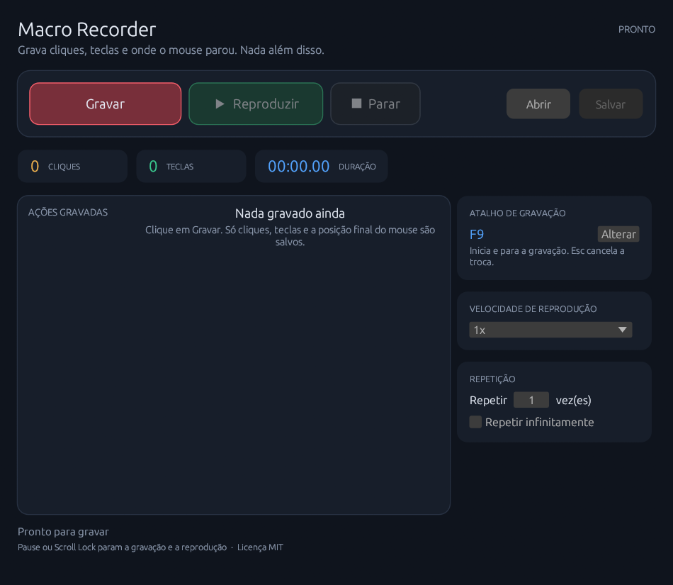

# Macro Recorder

Gravador de macros para Windows, feito em Rust (egui). Grava **apenas**:

- cliques do mouse (esquerdo e direito), com a posição de cada clique;
- teclas apertadas;
- a última posição do mouse.



## Recursos

- **Atalho de gravação configurável** (padrão: `F9`): inicia e para a gravação. Clique em *Alterar* e aperte a tecla desejada. Fica salvo em `%APPDATA%\MacroRecorder\config.json`.
- **Velocidade de reprodução**: 0.5x, 1x, 2x, 100x ou personalizada (1x a 100x).
- **Repetições**: número editável de vezes ou repetição infinita.
- Salvar e abrir macros em JSON.
- `Pause` ou `Scroll Lock` param a gravação e a reprodução.

## Compilar

```
cargo build --release
```

O executável fica em `target/release/macro_recorder.exe`.

## Estrutura

```
src/main.rs     interface, gravação e reprodução
src/keys.rs     mapeamento de teclas
src/config.rs   configurações do usuário
docs/           notas técnicas e screenshot
```

## Licença

MIT. Veja [LICENSE](LICENSE).
